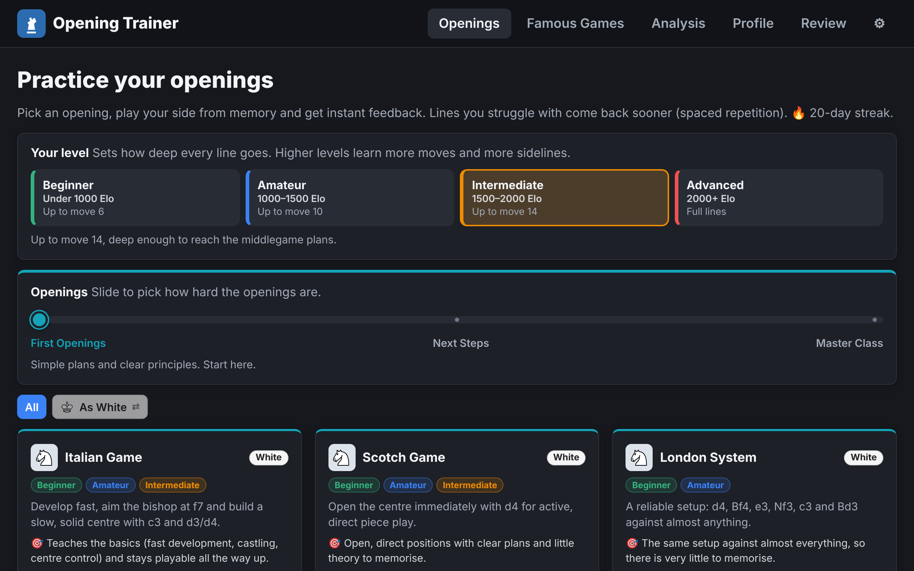
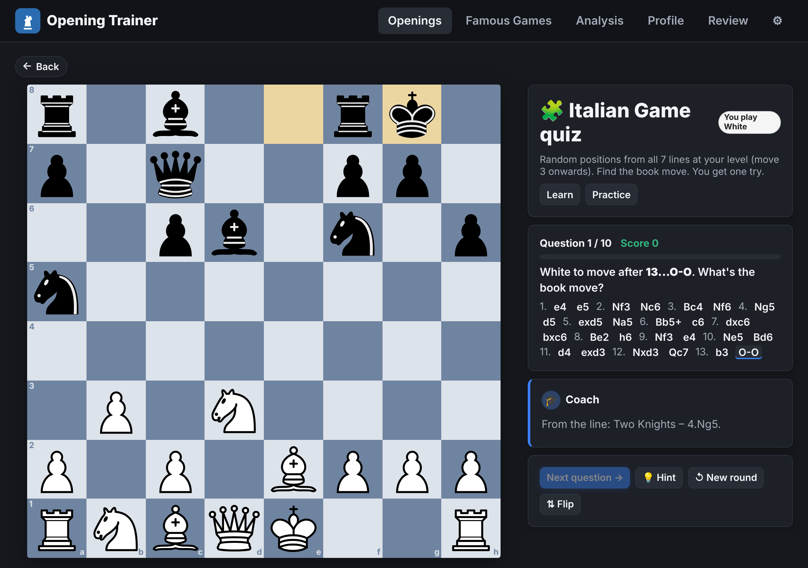
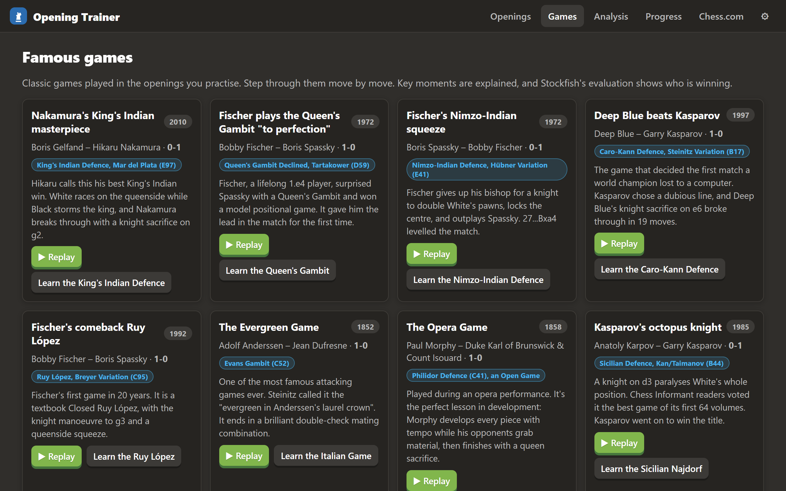
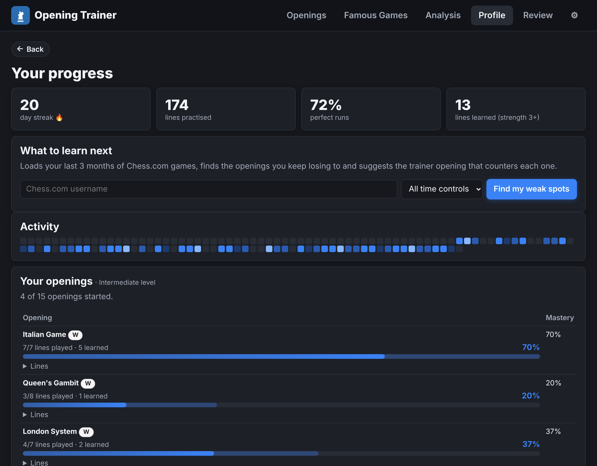

<div align="center">


# Opening Trainer

**Learn your chess openings by playing them, not by reading about them.**

Free, open source, runs in your browser. No account, no install, no ads.

### [▶ Try it now](https://vdmmm7491.github.io/chess-opening-trainer/)



</div>

---

## What it does

Pick an opening, play your side of the board, and the trainer tells you right away whether you found the book move. Lines you keep getting wrong come back sooner, and the ones you know well step aside. A few minutes a day is enough to make an opening stick.

**15 openings · 116 lines · a written explanation for every single move.**

| As White | As Black |
| --- | --- |
| Italian Game · Ruy López · Scotch Game · Queen's Gambit · London System · English Opening · Vienna Game · Alien Gambit · Alapin Sicilian · Advance vs French & Caro-Kann · Catalan Opening | Sicilian Najdorf · French Defence · Caro-Kann Defence · Scandinavian Defence · 1…e5 Open Games · King's Indian Defence · Nimzo-Indian Defence · Classical Sicilian · Accelerated Dragon · Sicilian Dragon · Slav Defence · Queen's Gambit Declined · Stonewall Dutch |

Not sure where to start? Type in your rating and the site shows you the openings that suit your level, with a short note on why.

---

## 🎓 A coach that explains every move

Turn on **Learn** mode and an arrow shows you the next move, while the coach explains the idea behind it: why this move, what it threatens, and what the plan is.


When you're ready, switch to **Practice** and play from memory. Get it wrong and the coach tells you why the book move is better. If your move is an actual mistake, Stockfish shows you exactly how the opponent punishes it, right there on the board. Then you try again.


---

## 🧩 Quiz yourself

Once you've practised a couple of lines, the quiz unlocks: 10 random positions from that opening, one try each. It's a good test of whether you actually *know* the moves or just remember the order.



---

## ♟ Replay famous games

Watch the openings you're learning played at the highest level. Fischer vs Spassky, Deep Blue vs Kasparov, the Opera Game and more, replayed move by move with the key moments explained.



---

## More to explore

<table>
<tr>
<td width="50%" valign="top">

### 🔍 Analysis board
Set up any position, see the engine's best move and play against Stockfish, all in your browser.


</td>
<td width="50%" valign="top">

### 📈 Track your progress
Daily streak, an activity calendar, and how well you know each opening and line. Add your Chess.com username and **What to learn next** finds the openings you keep losing to and suggests one that counters each.



</td>
</tr>
</table>

- **Game review.** Enter your Chess.com username to see how you score with each opening and the moves where you left your repertoire, then have Stockfish rate every move of any game and give both players an accuracy score.
- **Play on.** When the book line ends, keep playing the position against Stockfish.
- **Draw on the board.** Right-click and drag for arrows, right-click a square to highlight it.
- **Make it yours.** 6 piece sets, 6 board colours, dark or light theme.
- **Works on your phone.** Add it to your home screen and it feels like an app.

---

## Run it yourself

It's just a folder of web files, so there's nothing to build. Serve the folder with any local web server and open http://localhost:8080:

```bash
powershell -ExecutionPolicy Bypass -File tools/serve.ps1
```

```bash
python -m http.server 8080
```

(Opening `index.html` straight from your file explorer won't work: browsers block the chess engine from loading that way.)

<details>
<summary><b>Host your own copy on GitHub Pages</b></summary>

1. Fork or push this repo to GitHub.
2. Go to **Settings → Pages**, choose **Deploy from a branch**, pick `main` and `/ (root)`, and save.
3. After a minute your copy is live at `https://<your-username>.github.io/<repo-name>/`.

</details>

<details>
<summary><b>Add your own opening</b></summary>

Openings live in `js/openings.js`. Add an entry like this:

```js
{
  id: 'my-opening',            // unique, never change it (progress is saved under it)
  name: 'My Opening', eco: 'B00', side: 'w',   // side = the colour YOU play
  levels: ['beginner', 'intermediate'],          // beginner, intermediate, advanced, expert
  levelNote: 'Why it suits those players.',
  description: 'One sentence about the plans.',
  lines: [
    { name: 'Main line', moves: 'e4 e5 Nf3 Nc6 Bb5' },   // moves from the starting position
  ],
}
```

End each line on **your** move. Then open `tools/validate.html` to check that every move is legal and nothing is missing.

</details>

<details>
<summary><b>How the code is organised</b></summary>

```
index.html          the page shell
css/style.css       all styles
js/app.js           page routing
js/openings.js      the opening repertoire
js/board.js         the chessboard
js/engine.js        Stockfish wrapper
js/coach.js         move explanations (notes in js/line-notes*.js and js/notes*.js)
js/progress.js      saved progress and spaced repetition
js/views/           one file per page
engine/             Stockfish 19 (WebAssembly) + Stockfish 10 (asm.js fallback), run in your browser
tools/              local server and validator
```

</details>

---

## Credits & licence

This project is licensed under **GPL-3.0** (see `LICENSE`) because it ships Stockfish.

- **Engine**: [Stockfish](https://stockfishchess.org) by T. Romstad, M. Costalba, J. Kiiski, G. Linscott and contributors (GPL-3.0).
  Stockfish 19 lite, single-threaded WebAssembly build by Nathan Rugg and Chess.com ([stockfish.js](https://github.com/nmrugg/stockfish.js), npm `stockfish` 19.0.1,
  the source for `engine/stockfish-19-lite-single.js` and `.wasm`). Fallback for browsers without WebAssembly: Stockfish 10 compiled to
  JavaScript by Niklas Fiekas ([stockfish.js](https://github.com/niklasf/stockfish.js), the source for `engine/stockfish.js`).
- **Move logic**: [chess.js](https://github.com/jhlywa/chess.js) by Jeff Hlywa (BSD-2-Clause), loaded from jsDelivr.
- **Piece sets** (shipped in `assets/pieces/`, copied from [lichess](https://github.com/lichess-org/lila/blob/master/COPYING.md); details in `assets/pieces/LICENSE.md`):
  - cburnett (the default, "Classic") by Colin M.L. Burnett and Merida by Armando Hernandez Marroquin: GPLv2+
  - Staunty, Maestro and Cardinal by sadsnake1: CC BY-NC-SA 4.0, **non-commercial only**. Remove them before adding ads, paid features or anything else commercial.
- **Game data**: your games come from the [Chess.com Published-Data API](https://www.chess.com/news/view/published-data-api). They are downloaded in your browser and never stored on a server.
- **Famous games**: the move scores are historical facts, checked against the source linked on each game. The descriptions and the move-by-move commentary (`js/game-notes.js`) are written for this site, paraphrasing the games' published annotations.
- **Opening notes**: the coach's explanations are written for this site. "Read more" links point to the original articles rather than copying them.
- **Design**: the colours, board themes, move labels and badges are this project's own. The move symbols (`!!`, `!`, `?!`, `?`, `??`) are the traditional chess annotation marks.

### Trademarks

Chess.com, Lichess and Stockfish are names of their respective owners. They are used here only to say where data comes from and which engine runs. This project is not affiliated with or endorsed by any of them.

<div align="center">

**Found it useful? A ⭐ on the repo helps other players find it.**

</div>
