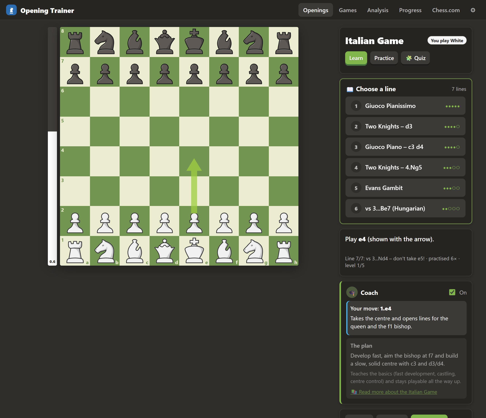
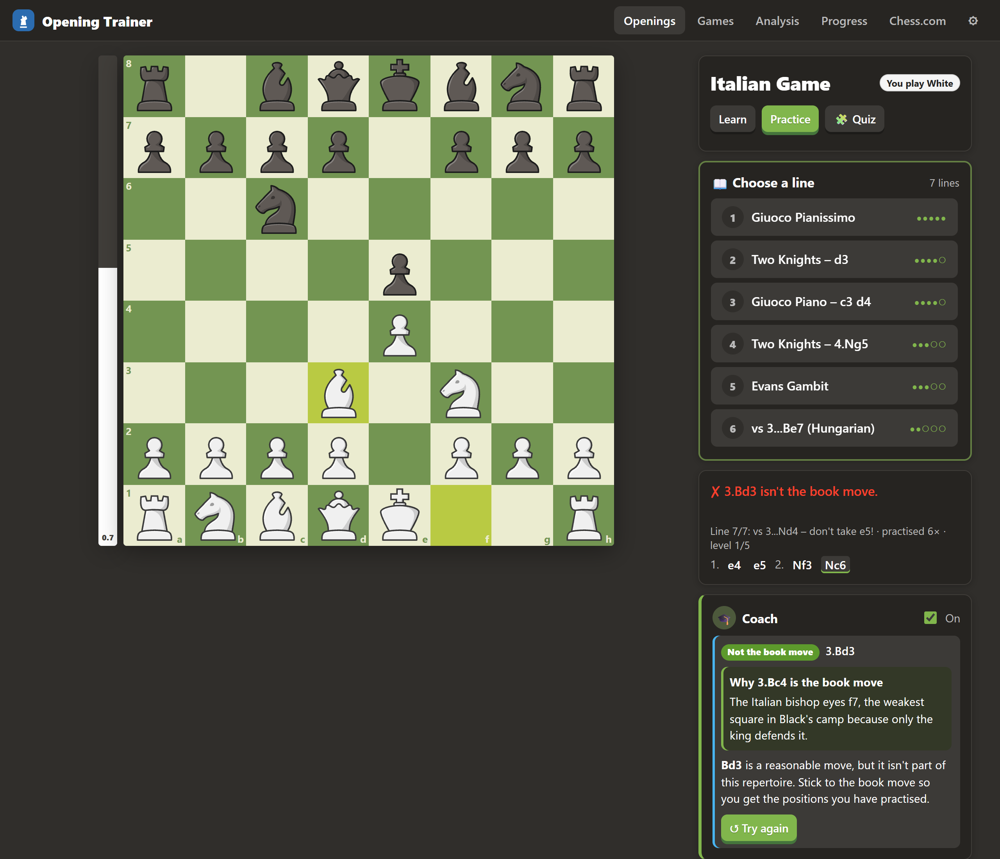
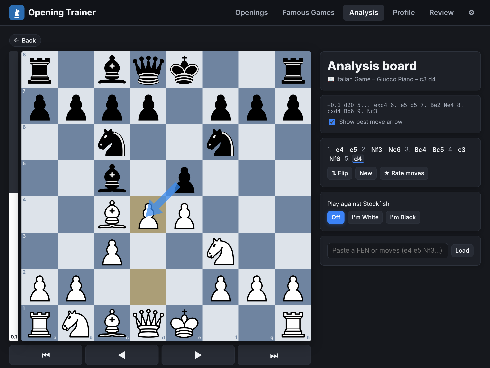

<div align="center">


# Opening Trainer

**Learn your chess openings by playing them, not by reading about them.**

Free, open source, runs in your browser. No account, no install, no ads.

### [▶ Try it now](https://vdmmm7491.github.io/chess-opening-trainer/)


</div>

---

**Contents:** [Quick start](#quick-start) · [The openings](#the-openings) · [Features](#features) · [Run it yourself](#run-it-yourself) · [Add an opening](#add-an-opening) · [Credits](#credits--licence)

## Quick start

1. **Open the site:** <https://vdmmm7491.github.io/chess-opening-trainer/>. Nothing to sign up for or install.
2. **Pick an opening.** The **Openings** page shows one difficulty tier at a time (First Openings → Next Steps → Master Class). Use the slider to switch tiers and the **White/Black** button to filter by colour. Not sure where to start? Stay on **First Openings**.
3. **Learn it.** Open the opening in **Learn** mode. An arrow shows the next book move and the coach explains why it's played. Just play the arrow moves.
4. **Practise it.** Switch to **Practice** and play the same lines from memory. If you play a wrong move, the coach tells you the right one and why, then you try again.
5. **Come back tomorrow.** Lines you get wrong come back sooner (spaced repetition). A few minutes a day is enough. Your progress is saved in your browser.

After that, try **⚔️ Punish** (common opponent mistakes and how to punish them) and the **Quiz**, or add your Chess.com username on the **Review** tab.

> Your progress lives in this browser only (localStorage). Clearing site data erases it. Use export/import on the **Profile** page to move it to another device.

---

## The openings

**15 openings · 116 lines · a written explanation for every move.** Each line is trimmed to your level (Beginner, Amateur, Intermediate or Advanced) so you only learn as deep as you need.

| Tier | As White | As Black |
| --- | --- | --- |
| **First Openings**<br>simple plans, start here | Italian Game · Scotch Game · London System · Vienna Game · Alien Gambit | Caro-Kann · Scandinavian · 1…e5 Open Games |
| **Next Steps**<br>more structure and theory | Ruy López · Queen's Gambit | French Defence |
| **Master Class**<br>sharp or heavy theory | English Opening | Sicilian Najdorf · King's Indian · Nimzo-Indian |

---

## Features

### 🎓 Learn and Practice, with a coach for every move

**Learn** shows the move and explains the idea: why it's played, what it threatens and what the plan is.



**Practice** makes you play from memory. If your move is an actual mistake, Stockfish shows how the opponent punishes it, right on the board.



### ⚔️ Punish mistakes

The positions right after typical opponent mistakes at your rating, such as the Fried Liver or the Légal trap. Find the moves that win material or the game. Open it with the **⚔️ Punish** button on an opening card.

### 🧩 Quiz

After you've practised a couple of lines, the quiz gives you 10 random positions from that opening, one try each.


### ♟ Famous Games

Fischer vs Spassky, Deep Blue vs Kasparov, the Opera Game and more, replayed move by move with commentary. Every move is rated.


### 🔍 Analysis board

Set up any position or paste moves or a FEN. See Stockfish's best move, play against it, or rate every move of a game.



### 📈 Profile and Review (Chess.com)

The **Profile** tab shows your streak, an activity calendar and how well you know each line. Add your Chess.com username to see:

- **Since you started training**: your results before and after you started using the trainer.
- **What to learn next**: the match-ups you keep losing, with a trainer opening that counters each.
- **Review**: how you score with each opening, where you left your repertoire, and a full Stockfish review of any game.


### Also

- **Play on:** when a book line ends, keep playing the position against Stockfish.
- **Draw on the board:** right-click and drag for arrows, right-click a square to highlight it.
- **Settings (⚙):** 5 piece sets, 7 board colours, dark or light theme, animations on/off.
- **Phone:** add it to your home screen and it works like an app.

---

## Run it yourself

There's no build step and no dependencies to install. It's a folder of static files. Serve it with any local web server, then open <http://localhost:8080>.

```bash
python3 -m http.server 8080
```

On Windows you can also use the bundled script:

```bash
powershell -ExecutionPolicy Bypass -File tools/serve.ps1
```

⚠️ Double-clicking `index.html` **won't work**. Browsers block the chess engine on `file://` pages, so you need a server.

**Host your own copy:** fork the repo, then go to **Settings → Pages → Deploy from a branch**, pick `main` / `/ (root)` and save. After a minute it's live at `https://<your-username>.github.io/<repo-name>/`.

---

## Add an opening

1. Add an entry to `OPENINGS` in `js/openings.js`:

   ```js
   {
     id: 'my-opening',          // unique, NEVER change it (progress is saved under it)
     name: 'My Opening', eco: 'B00', side: 'w',   // side = the colour YOU play
     tier: 'first',             // first | next | master
     levels: ['beginner', 'amateur'],              // beginner | amateur | intermediate | advanced
     levelNote: 'One sentence on why it suits those players.',
     description: 'One sentence about the plans.',
     lines: [
       { name: 'Main line', moves: 'e4 e5 Nf3 Nc6 Bb5' },   // SAN from the start, ending on YOUR move
     ],
   }
   ```

2. Add a coach note for every move of each line (`js/line-notes*.js`, one `"SAN|note"` entry per move).
3. Open `http://localhost:8080/tools/validate.html`. It checks that every move is legal, ids are unique, and lines and notes line up.

Never reorder or remove existing lines, because progress is keyed by line position. Add new lines at the end.

<details>
<summary><b>Where things are in the code</b></summary>

```
index.html              page shell and top navigation
css/style.css           all styles
js/app.js               hash routing and the Back button
js/views/               one file per page (home, trainer, quiz, punish, games, analysis, progress, chesscom)
js/openings.js          the repertoire: openings, tiers, levels, lines
js/line-notes*.js       coach notes for every book move (js/notes*.js override them)
js/coach.js             merges the notes and explains moves
js/punish.js            Punish-mode drills
js/games.js             famous game scores (commentary in game-notes.js, ratings in game-ratings.js)
js/chesscom.js          Chess.com games, game review and move rating
js/recommend.js         "What to learn next"
js/progress.js          saved progress, settings, spaced repetition
js/board.js             the chessboard
js/engine.js            Stockfish wrapper (one shared instance)
engine/stockfish.js     Stockfish 10 (asm.js), runs in a Web Worker
tools/                  local server, validator, game-rating tools
```

</details>

---

## Credits & licence

This project is licensed under **GPL-3.0** (see `LICENSE`) because it ships Stockfish.

- **Engine**: [Stockfish](https://stockfishchess.org) 10 by T. Romstad, M. Costalba, J. Kiiski, G. Linscott and contributors (GPL-3.0),
  compiled to JavaScript by Niklas Fiekas ([stockfish.js](https://github.com/niklasf/stockfish.js), the source for `engine/stockfish.js`).
- **Move logic**: [chess.js](https://github.com/jhlywa/chess.js) by Jeff Hlywa (BSD-2-Clause), loaded from jsDelivr.
- **Piece sets** (shipped in `assets/pieces/`, copied from [lichess](https://github.com/lichess-org/lila/blob/master/COPYING.md); details in `assets/pieces/LICENSE.md`):
  - cburnett (the default, "Classic") by Colin M.L. Burnett and Merida by Armando Hernandez Marroquin: GPLv2+
  - Staunty, Maestro and Cardinal by sadsnake1: CC BY-NC-SA 4.0, **non-commercial only**. Remove them before adding ads, paid features or anything else commercial.
- **Game data**: your games come from the [Chess.com Published-Data API](https://www.chess.com/news/view/published-data-api). They are downloaded in your browser and never stored on a server.
- **Famous games**: the move scores are historical facts, checked against the source linked on each game. The descriptions and the move-by-move commentary (`js/game-notes.js`) are written for this site, paraphrasing the games' published annotations.
- **Opening notes**: the coach's explanations are written for this site. "Read more" links point to the original articles rather than copying them.
- **Design**: the colours, board themes, move labels and badges are this project's own. The move symbols (`!!`, `!`, `?!`, `?`, `??`) are the traditional chess annotation marks.

### Trademarks

Chess.com, Lichess and Stockfish are names of their respective owners. They are used here only to say where data comes from and which engine runs. This project is not affiliated with or endorsed by any of them.

<div align="center">

**Found it useful? A ⭐ on the repo helps other players find it.**

</div>
